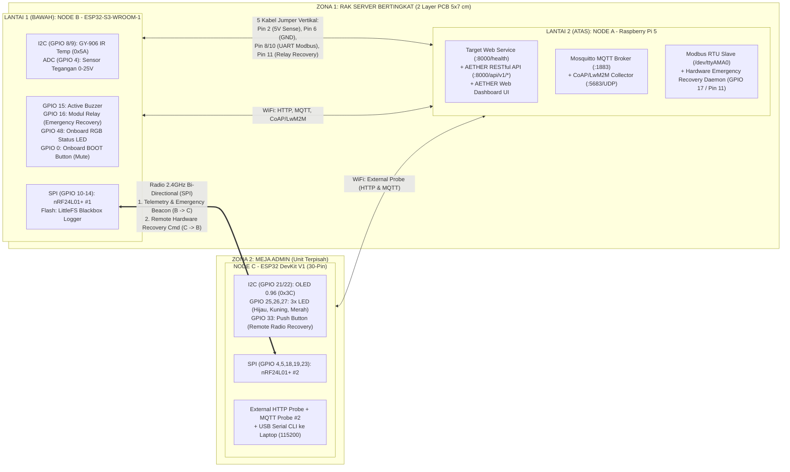

# Dokumentasi Master Teknis: Sistem **AETHER** (Hardware & Software Blueprint)
## **AETHER — Autonomous External Telemetry & Hardware Emergency Recovery**

Dokumen ini adalah **Single Source of Truth (Kontrak Teknis)** antara:
- **Tim Hardware** (Perakitan Fisik, Soldering PCB Bolong, & Pengkabelan 3 Node)
- **Tim Software** (Firmware `Node B ESP32-S3`, Firmware `Node C ESP32 30-Pin`, & Server/Dashboard `Node A Raspberry Pi 5`)

Seluruh nomor pin GPIO, alamat I2C, kanal SPI, baudrate UART, register Modbus RTU, topik MQTT (`aether/#`), URI CoAP/LwM2M, dan endpoint REST API **wajib mengacu persis pada dokumen ini** agar hardware dan software langsung terintegrasi 100% tanpa konflik.

> **Referensi Visual Pendamping:**
> - [SKEMATIK_VISUAL_NODE_AB.png](file:///c:/Users/luffy/Downloads/Proto_IoT/SKEMATIK_VISUAL_NODE_AB.png) — Diagram blok visual Lantai 1 (Node B) & Lantai 2 (Node A).
> - [DATASHEET_ANOTASI_NODE_AB.png](file:///c:/Users/luffy/Downloads/Proto_IoT/DATASHEET_ANOTASI_NODE_AB.png) — Peta *datasheet* asli `ESP32-S3` (diputar 180° sesuai posisi USB-C di atas) & `Raspberry Pi 5`.

---

## 1. Filosofi & Arsitektur 3 Node **AETHER**

**AETHER** (*Autonomous External Telemetry & Hardware Emergency Recovery*) memecahkan kelemahan utama monitoring internal (seperti Prometheus/Grafana) yang ikut buta saat server *hang* atau jaringan putus, melalui 3 pilar:
1. **Autonomous Cross-Protocol Diagnosis:** Membedakan *Service Crash*, *External Network Isolation*, *Thermal/Power Fault*, dan *Full Host Down* secara otonom.
2. **External Telemetry (In-Band & Out-of-Band):** Menggabungkan telemetri jaringan (HTTP, MQTT, CoAP/LwM2M) dengan jalur kabel fisik (Modbus RTU Serial, Sensor IR `GY-906`, Sensor Tegangan) serta gelombang radio independen 2.4GHz (`SPI nRF24L01+` menembus *aether* saat WiFi lumpuh).
3. **Hardware Emergency Recovery:** Memulihkan server yang *crash* secara fisik melalui saklar *Dry-Contact Relay* ke pin *Hardware Recovery* Raspberry Pi 5, baik secara otomatis (*Auto Self-Healing*) maupun via tombol panik radio jarak jauh dari meja admin (`Node C`).



---

## 2. Rekapitulasi 9 Protokol IoT pada **AETHER** (Sesuai RPS Pertemuan 4 – 13)

| No | Protokol RPS | Node yang Terlibat | Jalur Fisik / Port | Implementasi Teknis di **AETHER** |
| :-: | :--- | :--- | :--- | :--- |
| **1** | **Komunikasi Paralel / GPIO** *(Pert. 4)* | Node A, B, C | Digital Out/In & ADC | - **Node C**: 3-Bit Parallel LED Bus (`GPIO 25, 26, 27`) + Panic Button (`GPIO 33`).<br>- **Node B**: Buzzer (`GPIO 15`), Relay (`GPIO 16`), RGB LED (`GPIO 48`), Button (`GPIO 0`), ADC Tegangan (`GPIO 4`).<br>- **Node A**: Hardware Interrupt Recovery Input (`GPIO 17 / Pin 11`). |
| **2** | **UART Asinkron** *(Pert. 4)* | Node A, B, C | `UART0` (115200)<br>`UART1` (9600 8N1) | - `UART0` (USB Node B & C): Log diagnostik & CLI.<br>- `UART1` (`GPIO 17/18` Node B $\leftrightarrow$ `Pin 8/10` `/dev/ttyAMA0` Raspi 5): Jalur serial fisik *Out-of-Band*. |
| **3** | **Modbus Serial (RTU)** *(Pert. 5)* | Node B (Master) $\leftrightarrow$ Node A (Slave `0x01`) | Di atas `UART1` (`9600 bps, 8N1`) | - `FC 0x03` (*Read Holding Registers* `0x0000–0x0004`): Baca Suhu CPU Raspi, RAM %, Load, Uptime, Status Service.<br>- `FC 0x06` (*Write Single Register* `0x0005`): Perintah *restart service* via serial. |
| **4** | **Protokol I2C** *(Pert. 6)* | Node B & Node C | Node B: `GPIO 8/9`<br>Node C: `GPIO 21/22` | - **Node B**: Baca `GY-906 (MLX90614)` (`0x5A`, `100 kHz`) $\rightarrow$ `Object Temp` (pantat CPU Raspi 5) & `Ambient Temp`.<br>- **Node C**: Tampilkan dashboard lokal AETHER di `OLED SSD1306` (`0x3C`). |
| **5** | **Protokol SPI** *(Pert. 7)* | Node B (`nRF24 #1`) $\leftrightarrow$ Node C (`nRF24 #2`) | Bus Hardware SPI (`CSN, SCK, MOSI, MISO` + `CE`) | Transmisi paket biner 32-byte *Out-of-Band 2.4GHz* (`Channel 76, 250kbps, PA_LOW`) untuk telemetri darurat (`B` $\rightarrow$ `C`) & *Remote Emergency Recovery* (`C` $\rightarrow$ `B`). |
| **6** | **Protokol HTTP** *(Pert. 10)* | Node B & C (Client) $\rightarrow$ Node A (Server) | TCP Port `8000` | `GET /health?probe=B` dan `GET /health?probe=C` untuk mengecek kode HTTP (`200` vs `503`/`403`) dan *latency* (`ms`). |
| **7** | **RESTful API** *(Pert. 9)* | Web Dashboard $\leftrightarrow$ Node A | TCP Port `8000` | Endpoint JSON `/api/v1/status`, `/api/v1/incidents`, `/api/v1/fault/inject`, `/api/v1/actuator/cmd`. |
| **8** | **Protokol MQTT** *(Pert. 12)* | Node B & C $\leftrightarrow$ Broker Node A | TCP Port `1883` | Topik `aether/nodeB/telemetry`, `aether/nodeC/telemetry`, `aether/alert/incident`, `aether/cmd/actuator`, dan *Last Will (LWT)*. |
| **9** | **Protokol CoAP & LwM2M** *(Pert. 11 & 13)*| Node B $\leftrightarrow$ Node A | UDP Port `5683` | CoAP Server/Client dengan URI standar **OMA LwM2M / IPSO**: `/3/0` (*Device Object*), `/3303/0/5700` (*Temp*), `/3311/0/5850` (*Relay/Actuator*). |

---

# BAGIAN I: PANDUAN TIM HARDWARE (SOLDERING & WIRING)

## A. Perakitan `Node B` (Lantai 1 — Di Bawah Raspberry Pi 5)
- **Board**: `ESP32-S3-WROOM-1` ([datasheet_esp32s3.png](file:///c:/Users/luffy/Downloads/Proto_IoT/datasheet_esp32s3.png))
- **Orientasi di PCB `5 x 7 cm`**: **Port USB-C menghadap ke ATAS** (lihat [SKEMATIK_VISUAL_NODE_AB.png](file:///c:/Users/luffy/Downloads/Proto_IoT/SKEMATIK_VISUAL_NODE_AB.png)).
- **Komponen Pasif di Lantai 1**:
  - **Resistor**: **`0 Buah` (Tidak ada resistor di Lantai 1)** karena 3 LED + 3 Resistor dipasang di Node C.
  - **Kapasitor Elco**: **`1 Buah` (`10uF–100uF`)** wajib disolder pada soket `nRF24L01+ #1` (`Kaki +` ke `Pin 2 VCC 3.3V`, `Kaki - bergaris putih` ke `Pin 1 GND`).

### 1. Tabel Pinout Deretan Kanan `ESP32-S3` (Urut `#01` dari ATAS ke `#22` di BAWAH)

| Urutan dari Atas | Label Pin di Board `ESP32-S3` | Disolder ke Komponen / Jalur | Keterangan Hardware |
| :---: | :---: | :--- | :--- |
| **`#01`** | **`G` (`GND`)** | **Rel `GND` Utama Lantai 1** | Hubungkan ke semua `GND` modul, Kaki `-` Elco, Baut `COM` Relay, & `Pin 6` Raspi 5 |
| **`#02`** | **`5V`** | **Pin `VCC` Modul Relay** | Catu daya 5V untuk kumparan Relay |
| **`#03`** | **`14` (`GPIO 14`)** | **Pin 3 (`CE`) `nRF24L01+ #1`** | Chip Enable Radio |
| **`#04`** | **`13` (`GPIO 13`)** | **Pin 7 (`MISO`) `nRF24L01+ #1`** | SPI MISO |
| **`#05`** | **`12` (`GPIO 12`)** | **Pin 5 (`SCK`) `nRF24L01+ #1`** | SPI Clock |
| **`#06`** | **`11` (`GPIO 11`)** | **Pin 6 (`MOSI`) `nRF24L01+ #1`** | SPI MOSI |
| **`#07`** | **`10` (`GPIO 10`)** | **Pin 4 (`CSN`) `nRF24L01+ #1`** | SPI Chip Select |
| **`#08`** | **`9` (`GPIO 9`)** | **Pin `SCL` pada `GY-906`** | I2C Clock |
| `#09` & `#10` | `46` & `3` | *(Biarkan Kosong)* | Pin Strapping (Jangan disolder) |
| **`#11`** | **`8` (`GPIO 8`)** | **Pin `SDA` pada `GY-906`** | I2C Data |
| **`#12`** | **`18` (`GPIO 18`)** | **Jumper 3 ke `Pin 8 (TXD)` Raspi 5** | UART1 `RX` ESP32-S3 $\leftarrow$ `TX` Raspi 5 |
| **`#13`** | **`17` (`GPIO 17`)** | **Jumper 4 ke `Pin 10 (RXD)` Raspi 5** | UART1 `TX` ESP32-S3 $\rightarrow$ `RX` Raspi 5 |
| **`#14`** | **`16` (`GPIO 16`)** | **Pin `IN` Modul Relay** | Pemicu Relay *Hardware Emergency Recovery* |
| **`#15`** | **`15` (`GPIO 15`)** | **Kaki Positif (`+`) Active Buzzer** | Kaki negatif (`-`) Buzzer ke `Rel GND` |
| `#16`–`#18` | `7`, `6`, `5` | *(Biarkan Kosong)* | Indikator warna menggunakan **Onboard RGB LED (`GPIO 48`)** |
| **`#19`** | **`4` (`GPIO 4`)** | **Pin `S` Sensor Tegangan 0–25V** | Pin `+` tengah sensor tegangan **dikosongkan**; Pin `-` ke `Rel GND` |
| `#20` | `RST` | *(Biarkan Kosong)* | - |
| **`#21` & `#22`** | **`3V3`** | **Rel `3.3V` Lantai 1** | Hubungkan ke `VIN` GY-906, `Pin 2 (VCC)` nRF24L01+, & Kaki `+` Elco |

### 2. Tabel 5 Kabel Jumper Vertikal (`Lantai 1 Node B` $\updownarrow$ `Lantai 2 Raspberry Pi 5`)
Mengacu pada [datasheet_raspi5.png](file:///c:/Users/luffy/Downloads/Proto_IoT/datasheet_raspi5.png) dan [DATASHEET_ANOTASI_NODE_AB.png](file:///c:/Users/luffy/Downloads/Proto_IoT/DATASHEET_ANOTASI_NODE_AB.png):

```text
           POJOK ATAS GPIO RASPBERRY PI 5 (J8)
          ┌─────────────────┬─────────────────┐
     3.3V │ Pin 1           │ Pin 2       5V  │ ◄══ [JUMPER 1] Dari Baut Biru 'VCC' Sensor Tegangan 0-25V
     SDA  │ Pin 3           │ Pin 4       5V  │
     SCL  │ Pin 5           │ Pin 6      GND  │ ◄══ [JUMPER 2] Dari Rel GND Lantai 1 (& Baut 'GND' Sensor Tegangan + Baut 'COM' Relay)
          │ Pin 7           │ Pin 8      TXD  │ ◄══ [JUMPER 3] Dari Pin #12 [18] (GPIO 18 / RX1) ESP32-S3
     GND  │ Pin 9           │ Pin 10     RXD  │ ◄══ [JUMPER 4] Dari Pin #13 [17] (GPIO 17 / TX1) ESP32-S3
Relay NO ═╪►Pin 11 (GPIO17) │ Pin 12          │ ◄══ [JUMPER 5] Dari Baut Biru 'NO' Modul Relay
          └─────────────────┴─────────────────┘
```

---

## B. Perakitan `Node C` (Unit Meja Admin — `ESP32 DevKit 30-Pin`)
Mengacu pada [datasheet_esp32.png](file:///c:/Users/luffy/Downloads/Proto_IoT/datasheet_esp32.png):
- **Komponen Pasif di Node C**:
  - **3x Resistor `220 Ohm` (atau `330 Ohm`)**: Dipasang seri pada kaki negatif masing-masing LED (Hijau, Kuning, Merah) menuju `GND`.
  - **1x Kapasitor Elco (`10uF–100uF`)**: Dipasang pada `Pin 2 (VCC 3.3V)` dan `Pin 1 (GND)` soket `nRF24L01+ #2`.

| Komponen di Node C | Pin di Komponen | Solder ke Pin `ESP32 30-Pin` | Catatan Hardware |
| :--- | :--- | :--- | :--- |
| **Layar `OLED 0.96"` (I2C)** | `VCC` | **`3V3` (`3.3V`)** | Cek urutan label `GND/VCC` di modul OLED |
| | `GND` | **`GND`** | Ground |
| | `SCL` | **`GPIO 22` (`D22`)** | I2C Clock (Sisi Kanan Atas) |
| | `SDA` | **`GPIO 21` (`D21`)** | I2C Data (Sisi Kanan) |
| **`nRF24L01+ #2` (SPI)** | Pin 1 (`GND` - Pad Kotak) | **`GND`** | + Kaki Negatif (`-`, bergaris putih) Elco 10uF |
| | Pin 2 (`VCC`) | **`3V3` (`3.3V`)** | + Kaki Positif (`+`, hitam polos) Elco 10uF (**Wajib 3.3V!**) |
| | Pin 3 (`CE`) | **`GPIO 4` (`D4`)** | Sisi Kanan ESP32 |
| | Pin 4 (`CSN`) | **`GPIO 5` (`D5`)** | Sisi Kanan ESP32 |
| | Pin 5 (`SCK`) | **`GPIO 18` (`D18`)** | Sisi Kanan ESP32 |
| | Pin 6 (`MOSI`) | **`GPIO 23` (`D23`)** | Sisi Kanan ESP32 |
| | Pin 7 (`MISO`) | **`GPIO 19` (`D19`)** | Sisi Kanan ESP32 |
| | Pin 8 (`IRQ`) | *(Kosongkan)* | - |
| **3x LED Paralel (GPIO)** | Kaki `+` **LED Hijau** | **`GPIO 25` (`D25`)** | Kaki `-` $\rightarrow$ Resistor 220$\Omega$ $\rightarrow$ `GND` |
| | Kaki `+` **LED Kuning** | **`GPIO 26` (`D26`)** | Kaki `-` $\rightarrow$ Resistor 220$\Omega$ $\rightarrow$ `GND` |
| | Kaki `+` **LED Merah** | **`GPIO 27` (`D27`)** | Kaki `-` $\rightarrow$ Resistor 220$\Omega$ $\rightarrow$ `GND` |
| **Push Button** *(Remote Recovery)*| Kaki 1 | **`GPIO 33` (`D33`)** | Kaki 2 langsung ke `GND` (`INPUT_PULLUP`) |

---
---

# BAGIAN II: PANDUAN TIM SOFTWARE (SPESIFIKASI KODE & PROTOKOL **AETHER**)

## A. Definisi Pin (`#define`) Wajib di Firmware

### 1. Header Pin `Node B` (`ESP32-S3-WROOM-1` — In-Rack Watchdog)
```cpp
// ============================================================================
// AETHER NODE B (ESP32-S3-WROOM-1) PIN DEFINITIONS
// ============================================================================

// --- I2C (GY-906 MLX90614 Infrared Temperature) ---
#define PIN_I2C_SDA       8
#define PIN_I2C_SCL       9
#define MLX90614_I2C_ADDR 0x5A

// --- SPI (nRF24L01+ PA+LNA #1) ---
#define PIN_SPI_CSN       10
#define PIN_SPI_MOSI      11
#define PIN_SPI_SCK       12
#define PIN_SPI_MISO      13
#define PIN_NRF_CE        14

// --- UART1 / Modbus RTU Master ke Raspberry Pi 5 ---
#define PIN_MODBUS_TX     17   // Menuju Pin 10 (GPIO 15 / RXD) Raspi 5
#define PIN_MODBUS_RX     18   // Dari Pin 8 (GPIO 14 / TXD) Raspi 5
#define MODBUS_BAUD       9600
#define MODBUS_SLAVE_ID   1

// --- ADC & Paralel GPIO / Aktuator ---
#define PIN_VOLT_ADC      4    // ADC1_CH3 (Sensor Tegangan 0-25V, rasio 1:5)
#define PIN_BUZZER        15   // Active HIGH
#define PIN_RELAY_IN      16   // Trigger Relay untuk tarik Pin 11 Raspi 5 ke GND
#define PIN_BTN_MUTE      0    // Tombol BOOT bawaan ESP32-S3 (INPUT_PULLUP, Active LOW)
#define PIN_RGB_LED       48   // Built-in WS2812 RGB LED pada ESP32-S3
```
- **Rumus Pembacaan Tegangan di `ESP32-S3` (`GPIO 4`):**
  ```cpp
  float readServerVoltage() {
      uint32_t mv = analogReadMilliVolts(PIN_VOLT_ADC);
      return (mv / 1000.0f) * 5.0f;
  }
  ```
- **Aturan Wajib I2C `GY-906`:**
  Set `Wire.begin(PIN_I2C_SDA, PIN_I2C_SCL, 100000);` (kecepatan clock **wajib `100 kHz`** sesuai spesifikasi SMBus `MLX90614`).

---

### 2. Header Pin `Node C` (`ESP32 DevKit V1 30-Pin` — Remote Admin Console)
```cpp
// ============================================================================
// AETHER NODE C (ESP32 30-PIN) PIN DEFINITIONS
// ============================================================================

// --- I2C (OLED SSD1306 128x64) ---
#define PIN_OLED_SDA      21
#define PIN_OLED_SCL      22
#define OLED_I2C_ADDR     0x3C

// --- VSPI (nRF24L01+ PA+LNA #2) ---
#define PIN_NRF_CE        4
#define PIN_SPI_CSN       5
#define PIN_SPI_SCK       18
#define PIN_SPI_MISO      19
#define PIN_SPI_MOSI      23

// --- Paralel GPIO (3 LED Indikator & Push Button Remote Emergency Recovery) ---
#define PIN_LED_GREEN     25
#define PIN_LED_YELLOW    26
#define PIN_LED_RED       27
#define PIN_BTN_RECOVERY  33   // INPUT_PULLUP (Active LOW -> kirim paket RF Recovery ke Node B)
```

---

### 3. Konfigurasi Pin & Serial `Node A` (`Raspberry Pi 5`)
1. Aktifkan UART0 pada `Pin 8 & 10` dengan menambahkan baris berikut ke `/boot/firmware/config.txt` lalu *reboot*:
   ```ini
   dtparam=uart0=on
   ```
   Port serial akan tersedia di **`/dev/ttyAMA0`** (9600 bps, 8N1).
2. Gunakan library **`gpiozero`** (kompatibel penuh dengan chip RP1 di Raspberry Pi 5):
   ```python
   from gpiozero import Button
   # Pin 11 fisik = GPIO 17 BCM (Terhubung ke kontak NO Relay Node B)
   recovery_pin = Button(17, pull_up=True, bounce_time=0.1)
   recovery_pin.when_pressed = on_hardware_emergency_recovery
   ```

---

## B. Kontrak Paket Data Antar-Protokol **AETHER** (Data Contracts)

### 1. Kontrak Paket Radio SPI `nRF24L01+` (Node B $\longleftrightarrow$ Node C)
- **Konfigurasi Radio Wajib Sama di Node B & Node C:**
  - Channel: `76` (2476 MHz)
  - Data Rate: `RF24_250KBPS`
  - Power Amplifier: `RF24_PA_LOW` (wajib `PA_LOW` agar tidak saturasi di jarak dekat)
  - Pipe Address `Node B -> Node C`: `"AETH1"`
  - Pipe Address `Node C -> Node B`: `"AETH2"`
- **Struct Payload (`32 Bytes Fixed`, `__attribute__((packed))`)**:
  ```cpp
  enum AetherState : uint8_t {
      STATE_HEALTHY       = 0, // Hijau: Semua normal
      STATE_EXT_ISOLATED  = 1, // Kuning: Node B OK, tapi Node C gagal (jalur luar putus)
      STATE_SERVICE_DOWN  = 2, // Merah: HTTP gagal, tapi Modbus OK (aplikasi crash)
      STATE_NETWORK_DEAD  = 3, // Kuning/Merah: WiFi/Broker putus, mengandalkan radio nRF24
      STATE_HW_ANOMALY    = 4  // Merah: Overheat (IR > batas) atau Voltage Drop (< 4.5V)
  };

  struct __attribute__((packed)) AetherRfPacket {
      uint8_t  magic;          // 0xAE (AETHER Packet Identifier)
      uint8_t  msg_type;       // 1 = Telemetry B->C, 2 = Remote Recovery Command C->B
      uint8_t  state;          // Nilai dari enum AetherState (0..4)
      uint8_t  flags;          // Bit0: HTTP_B_OK, Bit1: MODBUS_OK, Bit2: WIFI_OK, Bit3: RELAY_ACTIVE
      float    voltage_v;      // Tegangan 5V Raspi (misal 5.05)
      float    ir_obj_c;       // Suhu permukaan Raspi dari GY-906 (misal 37.5)
      float    ir_amb_c;       // Suhu ruang dari GY-906 (misal 27.2)
      float    cpu_temp_c;     // Suhu inti CPU Raspi dari Modbus RTU (misal 49.0)
      uint16_t http_code;      // HTTP status terakhir (200, 503, 0=Timeout)
      uint16_t seq;            // Nomor urut paket SPI RF
      uint8_t  cmd;            // Jika msg_type==2: 1=TRIGGER_EMERGENCY_RECOVERY, 2=MUTE_ALARM
      uint8_t  reserved[7];    // Total packed 32 byte; koreksi ukuran disetujui pengguna
  };
  ```

---

**Koreksi kontrak yang disetujui pengguna:** `reserved` diperbesar dari 3 menjadi
7 byte agar ukuran packed benar-benar **32 byte**. Posisi seluruh field lain
tetap. Node B dan Node C wajib memakai format yang sama; reserved diisi nol oleh
pengirim dan diabaikan penerima. Float memakai IEEE-754 32 bit dan nilai multi-byte
memakai little-endian pada kedua ESP32. Header final bersama berada di
`firmware/libraries/AetherCore/src/AetherRfPacket.h` dan dipakai identik oleh
firmware terintegrasi Node B dan Node C. Bagian 08 mempertahankan salinan untuk uji mandiri.

### 2. Tabel Register `Modbus RTU` (Node B Master $\leftrightarrow$ Node A Slave `0x01`)
Berjalan di atas `UART1` (`9600 bps, 8N1`).

| Alamat Register (`uint16_t`) | Akses | Isi Data | Konversi Satuan |
| :---: | :---: | :--- | :--- |
| **`0x0000` (Reg 0)** | Read (`FC 0x03`) | Suhu CPU Internal Raspi 5 | Nilai $\times 10$ (misal `492` = `49.2 °C`) |
| **`0x0001` (Reg 1)** | Read (`FC 0x03`) | Penggunaan RAM Raspi 5 | Dalam `%` (`0` – `100`) |
| **`0x0002` (Reg 2)** | Read (`FC 0x03`) | Penggunaan CPU Load | Dalam `%` (`0` – `100`) |
| **`0x0003` (Reg 3)** | Read (`FC 0x03`) | Status Target Web Service | `1` = Running/Healthy, `0` = Crashed/Stopped |
| **`0x0004` (Reg 4)** | Read (`FC 0x03`) | Uptime Detik (Low 16-bit) | Detik berjalan (`0` – `65535`) |
| **`0x0005` (Reg 5)** | Write (`FC 0x06`) | Komando Recovery via Serial | Tulis `1` = Restart Target Service via Modbus |

---

### 3. Topik & Format JSON `MQTT` (`aether/#`, TCP Port `1883`)
- **`aether/nodeB/telemetry`** *(Publish tiap 2 detik dari Node B)*:
  ```json
  {
    "system": "AETHER",
    "node": "nodeB",
    "state": "HEALTHY",
    "voltage_v": 5.04,
    "ir_obj_c": 37.8,
    "ir_amb_c": 27.1,
    "modbus_ok": true,
    "cpu_temp_c": 49.2,
    "cpu_ram_pct": 34,
    "http_code": 200,
    "http_lat_ms": 11,
    "spi_rf_seq": 142
  }
  ```
- **`aether/nodeC/telemetry`** *(Publish tiap 2 detik dari Node C)*:
  ```json
  {
    "system": "AETHER",
    "node": "nodeC",
    "http_ext_code": 200,
    "http_ext_lat_ms": 18,
    "rf_rx_alive": true,
    "last_rf_seq": 142,
    "last_rf_state": 0
  }
  ```
- **`aether/alert/incident`** *(Publish saat perubahan state ke non-normal)*:
  ```json
  {
    "timestamp": 1731924000,
    "source": "nodeB",
    "diagnosis": "SERVICE_DOWN_HOST_ALIVE",
    "evidence": "HTTP=503, MODBUS=OK (CPU 49.2C), VOLT=5.04V",
    "action": "HARDWARE_EMERGENCY_RECOVERY_TRIGGERED"
  }
  ```
- **`aether/cmd/actuator`** *(Subscribe oleh Node B & Node C)*:
  ```json
  {
    "action": "TRIGGER_RECOVERY",
    "mute_buzzer": true
  }
  ```

---

### 4. Struktur Endpoint `CoAP & LwM2M Objects` (UDP Port `5683`)
Node B membuka CoAP Server pada port UDP `5683` dengan resource URI berstandar **OMA LwM2M / IPSO Smart Objects**:
- **`GET coap://<ip-node-b>:5683/3/0`** *(LwM2M Device Object `3`)*:
  Mengembalikan JSON ringkas: `{"mfg":"AETHER","model":"S3-Watchdog","state":0,"v":5.04}`
- **`GET coap://<ip-node-b>:5683/3303/0/5700`** *(IPSO Temperature Sensor `3303`)*:
  Mengembalikan nilai suhu `GY-906` (`"37.80"`).
- **`PUT coap://<ip-node-b>:5683/3311/0/5850`** *(IPSO Light/Actuator Control `3311`)*:
  Payload `"1"` = Trigger Relay Hardware Emergency Recovery, `"0"` = Mute Buzzer / Reset Alarm.

---

### 5. Endpoint `HTTP Probe` & `RESTful API` di Server `Node A` (TCP Port `8000`)
Server Python (`FastAPI`) di Raspberry Pi 5 menyediakan:
1. **`GET /health?probe={B|C}`** *(Protokol HTTP Probe)*:
   - Normal: `200 OK` `{"system": "AETHER", "status": "ok"}`.
   - Mode *Service Crash*: `503 Service Unavailable`.
   - Mode *External Firewall Block*: `200 OK` untuk `probe=B`, tetapi `403 Forbidden` untuk `probe=C`.
2. **`GET /api/v1/status`** *(RESTful API)*:
   Mengembalikan gabungan seluruh metrik terbaru dari Node A, Node B, dan Node C beserta kesimpulan diagnosis **AETHER** dan status ke-9 protokol.
3. **`POST /api/v1/fault/inject`** *(RESTful API untuk Tombol Demo di Dashboard)*:
   Body: `{"mode": "NORMAL" | "SERVICE_CRASH" | "EXT_BLOCK" | "OVERHEAT_SIM"}`
4. **`POST /api/v1/actuator/cmd`** *(RESTful API untuk Kontrol Aktuator)*:
   Body: `{"target": "RELAY_RECOVERY" | "MUTE_ALARM" | "COAP_POLL"}`

---

## C. Daftar Library yang Perlu Diinstal oleh Tim Software

### 1. Arduino IDE (Untuk `Node B ESP32-S3` & `Node C ESP32`)
Instal melalui *Library Manager* Arduino IDE:
- `RF24` by TMRh20 *(untuk `nRF24L01+` SPI)*
- `Adafruit MLX90614 Library` *(untuk `GY-906` I2C di Node B)*
- `Adafruit SSD1306` & `Adafruit GFX Library` *(untuk `OLED` I2C di Node C)*
- `PubSubClient` *(untuk `MQTT`)*
- `ArduinoJson` *(untuk parsing/serialisasi payload REST & MQTT)*

### 2. Raspberry Pi 5 (`Node A` — Python 3)
```bash
sudo apt update && sudo apt install -y mosquitto mosquitto-clients python3-pip python3-gpiozero
pip install fastapi uvicorn paho-mqtt pyserial requests --break-system-packages
```
